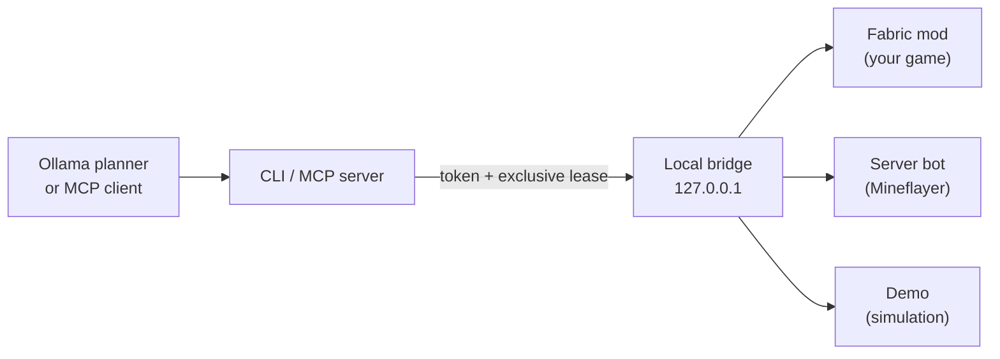

# Minecraft Autopilot

[](https://github.com/BrendanH18/minecraft-autopilot/actions/workflows/ci.yml)
[](LICENSE)

Hand **the Minecraft Java character you're already playing** to a local AI agent for a bounded task, such as "collect eight logs, store them, and come home", then take it back with one key.

The agent can be a local [Ollama](https://ollama.com/) model or any [MCP](https://modelcontextprotocol.io/) client, such as Claude Code. It acts through a Fabric client mod that drives your logged-in player, or through a standalone bot that keeps a server session going while your game is closed. Every action goes through an authenticated local bridge with exclusive control, time limits, and an emergency stop.

> **Status: experimental.** v0.1.0 is in preparation for Minecraft Java 1.21.1.
>
> - **Verified live in development worlds:** gathering, storing, withdrawing and crafting with the server bot, real Ollama and MCP agents driving the bot, and storage on the Fabric development client.
> - **Still needs live acceptance:** the packaged Fabric mod in a normal launcher, and handing an account between your client and the bot.
>
> See the [release checklist](docs/RELEASE.md) and [validation record](docs/DEVELOPMENT.md#validation).

## What it can do

| | |
| --- | --- |
| **Observe** | Health, hunger, inventory, position, saved home, nearby blocks, containers, and hostile mobs |
| **Move** | Walk to coordinates or a saved home |
| **Gather** | Collect logs, dirt, sand, or cobblestone, then return to where it started |
| **Store** | Deposit into or withdraw from a chest or barrel within 16 blocks |
| **Craft** | Planks, sticks, crafting tables, torches, chests, furnaces, and wooden or stone pickaxes, axes, and shovels. Places a held crafting table if none is nearby |
| **Survive** | Eat when hungry and retreat to a saved shelter when health is low |
| **Plan** | An Ollama planner picks one checked action at a time within step and time limits |
| **Verify** | Check inventory gains, stored or crafted items, and the return home, independently of what the model claims |
| **Hand back** | F8 or any game menu returns control in Fabric; `stop` works from any terminal; a dead client's lease expires in eight seconds |

Combat, building, and smelting are not supported. Withdraw and craft are newer than the other actions and are marked experimental.

## Try it in two minutes

You need [Node.js](https://nodejs.org/) **22.12 or newer**. Minecraft and a model are not required for this:

```sh
git clone https://github.com/BrendanH18/minecraft-autopilot.git
cd minecraft-autopilot
npm ci
npm start -- demo --smoke
```

This runs a **simulated** player through the real bridge: it saves a home, walks, collects logs, stores them, eats, returns home, and releases control.

To drive the simulation yourself, leave `npm start -- demo` running and use a second terminal:

```sh
npm start -- observe
npm start -- set-home
npm start -- collect oak_log 8
npm start -- craft oak_planks 4
npm start -- home
npm start -- stop
```

## Play for real

| Mode | Use it when | You need |
| --- | --- | --- |
| **Fabric mod** | The agent should control the character you are playing, in single-player or multiplayer | Minecraft Java 1.21.1 with Fabric Loader 0.16.14+ and the three jars below |
| **Server bot** | A dedicated server should keep your character busy while your game is closed | A Java 1.21.1 server that allows it, and your account |

Only use automation on servers where it is allowed. A single-player world cannot continue through the bot after you close it.

### Install the Fabric mod

Building needs a full **Java 21 JDK** (`java`, `javac`, and `jar` on PATH). Verifying the archive also needs `unzip`. The first build downloads the pinned dependencies when you pass `--allow-downloads`:

```sh
npm run setup:mod -- --allow-downloads
node scripts/gradle.js build --allow-downloads
node scripts/package-mod.js --allow-downloads
npm run verify:mod
```

Later builds run offline with `npm run build:mod`.

1. Create a Minecraft Java **1.21.1** profile and install [Fabric Loader](https://fabricmc.net/use/installer/) for it.
2. Copy all three jars from `dist/mods/` into that profile's `mods` folder: `minecraft-agent-0.1.0.jar`, `fabric-api-0.116.18+1.21.1.jar`, and `baritone-api-fabric-1.11.3.jar`.
3. Launch the game and enter a world or server.
4. Attach the CLI to the running game and look around:

   ```sh
   npm start -- attach "/path/to/game-directory/config/minecraft-agent/bridge.json"
   npm start -- observe
   ```

   On macOS the default game directory is `~/Library/Application Support/minecraft`. The attachment is remembered.

Save a home **inside a shelter you built**, then try a small task:

```sh
npm start -- set-home
npm start -- collect oak_log 8
npm start -- home
```

Counts mean *additional* items, not a final total. Collecting can dig into terrain, so use an area you don't mind changing. Cobblestone needs a pickaxe.

### Use the server bot

The [server bot guide](docs/USAGE.md#use-the-server-bot) covers connecting with your account. Never connect the bot and your regular client as the same account at the same time.

## Give an agent a task

**With a local model.** Install [Ollama](https://ollama.com/) and pick a model that supports structured JSON output; `qwen3.5:4b-mlx` passed the recorded live tests. Save a home first, then:

```sh
npm start -- agent "Collect eight more oak logs and return home" \
  --model YOUR_LOCAL_MODEL --steps 20 --minutes 10 \
  --verify-collect oak_log:8 --verify-home
```

The `--verify-*` flags are checked against the game's actual state, not the model's description. The run ends with `criteria_met`, or exits with code 2 if any criterion is unmet. Combine them for longer tasks, for example `--verify-withdraw`, `--verify-craft`, and `--verify-deposit`; see [Run an Ollama task](docs/USAGE.md#run-an-ollama-task).

**With an MCP client.** Point your client at the bundled MCP server:

```json
{
  "mcpServers": {
    "minecraft": {
      "command": "node",
      "args": ["/absolute/path/to/minecraft-autopilot/src/cli.js", "mcp"]
    }
  }
}
```

The agent gets 11 tools: it observes freely, but must explicitly take control before acting and release it afterwards. See [Connect an MCP agent](docs/USAGE.md#connect-an-mcp-agent).

## Taking control back

- **F8** returns control in Fabric. Opening any menu, dying, disconnecting, or changing dimension does too, and closing the menu does not resume the agent.
- `npm start -- stop` ends any session, including one started by another process.
- **Ctrl+C** stops the CLI or planner. In the server bot's terminal, it disconnects the bot so you can log back in.
- If the controlling process dies, its lease expires after eight seconds and all activity stops.

The game must stay running and the computer awake. A saved home is a waypoint, not a guarantee of safety.

## How it works



The bridge accepts one controlling session at a time, runs one bounded action at a time, and refuses actions it can't validate. Fabric uses Baritone for movement and mining, and the bot uses mineflayer-pathfinder. The [bridge protocol](docs/protocol.md) documents every action and observation.

## Documentation

| Guide | What's in it |
| --- | --- |
| [Usage](docs/USAGE.md) | Every CLI command, the server bot, Ollama, MCP, and troubleshooting |
| [Bridge protocol](docs/protocol.md) | Authentication, leases, action contracts, and observations |
| [Development](docs/DEVELOPMENT.md) | Setup, architecture, tests, live validation, and known issues |
| [Roadmap](docs/ROADMAP.md) and [release checklist](docs/RELEASE.md) | What v0.1 needs and what comes after |
| [Live acceptance](docs/LIVE-ACCEPTANCE.md) and [session records](docs/ACCEPTANCE.md) | Scripted bot scenarios against a local server, and how live sessions are recorded for release |
| [Changelog](CHANGELOG.md) | What's in the upcoming release |

Run `npm start -- doctor` to check prerequisites without connecting to Minecraft. Treat bridge files and sign-in caches like passwords.

### Offline planning tools

The CLI also ships offline calculators for routes, resource and storage budgets, routine checks, build and farm estimates, and planning studies. Browse them with `mc-agent study catalog`, or try one of the 1,000 runnable comparisons listed by `mc-agent study recipes`. [Planning tools index](docs/IMPROVEMENTS.md) · [Recipe usage](docs/PLANNING-STUDIES.md#runnable-comparison-recipes)

## Contributing and license

Issues and pull requests are welcome; start with [CONTRIBUTING.md](CONTRIBUTING.md). The CLI is installed from source and is not on npm.

The project is [MIT licensed](LICENSE). [Fabric](https://fabricmc.net/), [Baritone](https://github.com/cabaletta/baritone), [Mineflayer](https://github.com/PrismarineJS/mineflayer), [mineflayer-pathfinder](https://github.com/PrismarineJS/mineflayer-pathfinder), and the [MCP SDK](https://github.com/modelcontextprotocol/typescript-sdk) keep their own licenses; the packaged Fabric API and Baritone jars are unmodified, checksum-pinned releases.

Not an official Minecraft product. Not approved by or associated with Mojang or Microsoft.
